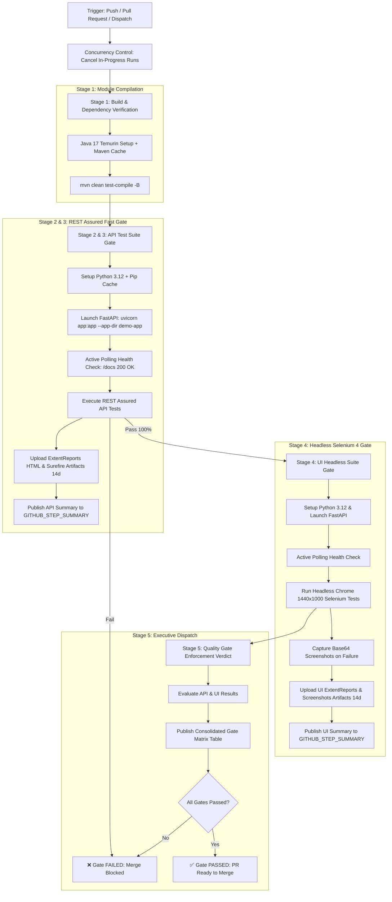

# Enterprise CI/CD Quality Architecture & Standard Operating Procedure (SOP)
## Multi-Stage Continuous Testing, Automated Quality Gates & Deployment Guide

---

## 1. 🏛️ Executive Summary & Architecture Principles

In modern enterprise financial and insurance systems, automated testing cannot be an afterthought executed at the end of a sprint. It must act as a **continuous, non-negotiable quality gate** embedded directly within the developer's commit and Pull Request lifecycle.

This document outlines the standard Continuous Integration and Continuous Delivery (CI/CD) architecture, operational procedures, and gating rules governing the **Enterprise Insurance Claims Platform**.

### Core Architecture Tenets:
1. **Shift-Left Quality Enforcement**: Catch syntax, dependency, schema, and calculation defects within seconds of code commit.
2. **Strict Gating Hierarchy**: Fast API contract & boundary tests execute first (< 20s SLA); heavier browser-based E2E tests only execute after API validation passes.
3. **Zero-Defect Release Gate for P0**: 0 tolerance for calculation regressions, financial discrepancies, or boundary assertion failures.
4. **Automatic Flakiness Mitigation**: Built-in TestNG dynamic retry mechanism (`IRetryAnalyzer` + `IAnnotationTransformer`) avoids false positives from network or rendering blips.
5. **Stakeholder & Executive Transparency**: Every pipeline run automatically archives interactive ExtentReports 5.x HTML Spark dashboards with embedded failure screenshots and posts markdown summaries directly to GitHub Pull Requests.

---

## 2. 🔀 Branching Strategy & Git Workflow Governance

To ensure trunk stability and continuous release readiness, the repository follows a **Trunk-Based Development** model with short-lived feature branches:

```
feature/claim-calculation-fix ───► Pull Request ───► [Stage 1-5 CI Gates] ───► Merge into 'main'
                                                           │
                                                           ▼ (If Any Gate Fails)
                                                     ❌ Merge Blocked
```

### Pull Request & Merge Policies:
* **Branch Protection Rules on `main`**:
  * Direct pushes to `main` are restricted in production teams.
  * Require Pull Request with at least 1 peer code review.
  * Require all status checks to pass before merging:
    * `Stage 1: Build & Verify Modules`
    * `Stage 2 & 3: API Test Suite (REST Assured)`
    * `Stage 4: UI Headless Suite (Selenium 4)`
    * `Stage 5: Quality Gate Enforcement Verdict`
* **Commit Message Standard**:
  * Adhere to Conventional Commits: `feat:`, `fix:`, `test:`, `refactor:`, `chore:`, `ci:`.

---

## 3. 🔄 Multi-Stage CI Pipeline Architecture (`ci.yml`)

The primary CI pipeline triggers on every **Push**, **Pull Request**, or manual **Workflow Dispatch**:



### Stage-by-Stage Breakdown:

| Stage | Responsibility | Tooling | Quality SLA | Failure Action |
| :--- | :--- | :--- | :--- | :--- |
| **Stage 1: Build & Verification** | Validates Java syntax, dependencies, pom hierarchies across all 3 modules (`automation-core`, `api-restassured`, `ui-selenium`). | Maven, OpenJDK 17 | Zero compile errors | Immediate pipeline termination |
| **Stage 2: Health Check** | Spins up FastAPI backend and verifies readiness using an active polling loop on `http://127.0.0.1:8000/docs` (up to 30 retries). | Python 3.12, Uvicorn | Server up in < 5 seconds | Fails before running tests |
| **Stage 3: API Test Gate** | Executes 100% of P0 claims calculation, deductible validations, and schema boundary tests. | REST Assured, TestNG, Jayway JsonPath | Execution time < 20 seconds. **0 failures allowed**. | **Blocks UI stage and blocks PR merge** |
| **Stage 4: UI Headless Gate** | Executes end-to-end user journeys (policy lookup, claim form input, calculation verification, submission) in Headless Chrome. | Selenium WebDriver 4, PageFactory, ChromeOptions | 0 P0/P1 journey failures | Uploads failure screenshot and blocks PR |
| **Stage 5: Quality Gate Verdict** | Consolidates status, evaluates compliance against SLA benchmarks, and renders an executive status table on the GitHub PR. | GitHub Actions Step Summary, ExtentReports 5.x | 100% pass rate across blocking gates | Sets build status to Failed if any gate violates SLA |

---

## 4. 🌙 Nightly Cross-Browser Regression Pipeline (`nightly-crossbrowser.yml`)

While PR pipelines prioritize **rapid developer feedback** using Headless Chrome, the Nightly Regression Gate ensures **cross-browser compatibility and environment parity**.

### Trigger & Configuration:
* **Schedule**: Automated daily at `00:00 UTC` (`cron: '0 0 * * *'`).
* **Manual Dispatch**: QA Engineers can trigger tests anytime with custom suite selection (`testng-crossbrowser.xml`, `testng-smoke.xml`, `testng.xml`).
* **Parallel Browser Matrix**:
  * **Google Chrome** (Headless, 1440x1000)
  * **Mozilla Firefox** (Headless, 1440x1000)
* **Isolation (`fail-fast: false`)**: If one browser encounters an issue, the pipeline continues executing the remaining browsers to provide complete cross-platform test intelligence.
* **Reporting**: Generates isolated artifacts for each browser:
  * `extent-reports-chrome`
  * `extent-reports-firefox`

---

## 5. 🎯 Quality Gates & SLA Benchmarks

The Quality Architect establishes quantitative SLAs enforced programmatically:

```
┌──────────────────────────────────────┬───────────────────────────────┬──────────────────────┐
│ Quality Gate                         │ Measurement / Rule            │ Target SLA           │
├──────────────────────────────────────┼───────────────────────────────┼──────────────────────┤
│ 1. API Calculation SLA               │ RestAssured Calculation tests │ 100% Pass (0 Defect) │
│ 2. CI Fast Feedback SLA              │ Time to complete Stage 1-3    │ < 20 seconds         │
│ 3. UI E2E Journey SLA                │ Selenium Headless Regression  │ 0 P0/P1 Failures     │
│ 4. Total PR Pipeline Duration        │ All stages end-to-end         │ < 2 minutes          │
│ 5. Flakiness Threshold               │ Consecutive clean CI runs     │ 0 Flaky tests / 50   │
│ 6. Artifact Retention Period         │ ExtentReports HTML & Logs     │ 14 Days              │
└──────────────────────────────────────┴───────────────────────────────┴──────────────────────┘
```

---

## 6. 📊 Business & Stakeholder Reporting Strategy

Every pipeline execution generates executive test artifacts designed for developers, QA leads, and business stakeholders:

### 1. Interactive ExtentReports 5.x Spark HTML
* **API Reports**: Archived under `automation/api-restassured/target/extent-reports/ExtentReport.html`
* **UI Reports**: Archived under `automation/ui-selenium/target/extent-reports/ExtentReport.html`
* **Features Included**:
  * Pass/Fail percentage pie charts.
  * Breakdown by category / tag (e.g., `@P0-Calculation`, `@Smoke`, `@UI-Validation`).
  * Base64 embedded screenshots automatically attached on UI test failure.
  * System metadata (OS, Java version, Base URL, Environment tag).

### 2. GitHub PR Step Summary
Every run publishes a native Markdown report directly in the GitHub Actions run summary:

```markdown
## 🏛️ Enterprise Quality Gate Summary

| Pipeline Gate | Stage | Result | Quality SLA / Threshold |
| :--- | :--- | :--- | :--- |
| **API Calculation Gate** | Stage 3 (REST Assured) | ✅ PASS | 100% Pass (0 Calculation Defects) |
| **UI Headless Gate** | Stage 4 (Selenium 4) | ✅ PASS | 0 P0/P1 Failures Allowed |
| **Artifact Retention** | Stage 5 (ExtentReports) | ✅ ACTIVE | 14-day retention for Spark HTML & Screenshots |

### ✅ Quality Gate PASSED
All automated API calculations and E2E UI journeys verified successfully.
```

---

## 7. ☁️ Dual-Environment Cloud Architecture & Promotion Flow

In adherence to enterprise financial and insurance QA standards, the system operates across two physically isolated cloud environments on **Render.com**:

```
┌────────────────────────────────────────────────────────┐         ┌────────────────────────────────────────────────────────┐
│ 🧪 DEDICATED QA ENVIRONMENT                            │         │ 🚀 DEDICATED PRODUCTION ENVIRONMENT                    │
├────────────────────────────────────────────────────────┤         ├────────────────────────────────────────────────────────┤
│ • URL: https://insurance-claims-demo.onrender.com      │ ──────► │ • URL: https://insurance-claims-prod.onrender.com      │
│ • Branch: 'main'                                       │ Release │ • Branch: Release Tags ('v*.*.*') / Manual Gate        │
│ • Purpose: Full Regression & System Integration (SIT)  │ Gating  │ • Purpose: Live Customer Claims Processing             │
│ • Data: Synthetic Test Claims, Edge Cases & Retries    │         │ • Data: Customer Data (Strictly Isolated from QA)      │
└────────────────────────────────────────────────────────┘         └────────────────────────────────────────────────────────┘
```

### Environment Topologies & Endpoints:

| Environment | Cloud Service Name | Base URL | Swagger Docs | Auto-Deploy Trigger |
| :--- | :--- | :--- | :--- | :--- |
| **QA / Testing** | `insurance-claims-demo` | `https://insurance-claims-demo.onrender.com` | `/docs` | Merges / Pushes to `main` |
| **Production** | `insurance-claims-prod` | `https://insurance-claims-prod.onrender.com` | `/docs` | Promoted via `release-production.yml` |

### Service Configuration Specifications (FastAPI + Uvicorn):
* **Runtime**: Python 3.12
* **Root Directory**: `demo-app`
* **Build Command**: `pip install -r requirements.txt`
* **Start Command**: `uvicorn app:app --host 0.0.0.0 --port $PORT`
* **Health Check Endpoint**: `/docs` (Active polling by CI runners)

---

### 7.1 🚀 Production Promotion & Post-Deploy Smoke Gate (`release-production.yml`)
When code on the QA environment receives official QA sign-off, the automated production pipeline promotes the verified artifact through a 3-stage gate:

1. **Stage 1 (QA Release Sign-off Verification)**:
   - Validates that the release candidate passes 100% of P0 tests on the QA environment before initiating deployment.
2. **Stage 2 (Controlled Production Deployment)**:
   - Deploys the immutable build artifact to Production (`https://insurance-claims-prod.onrender.com`).
   - Polls Production `/docs` health check until server is fully awake and responsive.
3. **Stage 3 (Post-Deployment Smoke Sanity Gate)**:
   - Executes `testng-smoke.xml` suites (REST Assured and Headless Chrome) against the live Production server.
   - Archives 30-day retained Production verification ExtentReports and publishes the executive release verdict to `$GITHUB_STEP_SUMMARY`.

---

## 8. 🛠️ Developer & QA Standard Operating Procedures (SOP)

### SOP-01: Local Pre-Flight Check (Before Creating a PR)
Before pushing code or opening a Pull Request, developers must run the local pre-flight check:

```powershell
# 1. Verify compilation across all modules
mvn clean test-compile -f automation/pom.xml

# 2. Run API tests locally (ensure demo-app is running on port 8000)
mvn test -f automation/pom.xml -pl api-restassured -am

# 3. Verify ExtentReport generation
Start-Process automation/api-restassured/target/extent-reports/ExtentReport.html
```

---

### SOP-02: Investigating a CI Failure
If a GitHub Actions pipeline fails on a PR:

1. **Check GitHub Step Summary**: Open the failed run in GitHub Actions to see which gate failed (`Stage 3: API` or `Stage 4: UI`).
2. **Download Test Artifacts**:
   * Scroll to the **Artifacts** section at the bottom of the summary page.
   * Download `api-test-reports` or `ui-test-reports`.
   * Unzip and open `ExtentReport.html`.
3. **Inspect Failure Details**:
   * In the ExtentReport, locate the red failed test step.
   * For UI failures, review the attached timestamped screenshot showing the exact page state at the moment of failure.
   * Inspect the stack trace and request/response payloads.
4. **Reproduce Locally**:
   ```powershell
   mvn test -f automation/pom.xml -pl ui-selenium -am -Dtest=<FailingTestClassName>
   ```

---

### SOP-03: Handling Flaky Tests & Retries
1. **Automatic Retry**: Test classes inherit `RetryAnalyzer` through `AnnotationTransformer`. A flaky test is automatically retried up to **2 times** before being marked as failed.
2. **Quarantine Procedure**: If a test continues to fail intermittently due to environment/third-party delays:
   * File a defect ticket with priority **P1-Flaky**.
   * Tag the test method with `@Test(enabled = false, description = "JIRA-1234: Quarantined due to timeout")`.
   * A quarantined test must be resolved within 1 sprint.

---

### SOP-04: Promoting QA to Production
When all regression tests on the QA environment pass and the QA Lead grants formal sign-off:

1. **Option A (Manual Promotion via GitHub Actions UI)**:
   * Navigate to **Actions** ➔ **Production Release & Deployment Gate**.
   * Click **Run workflow**, enter version tag (e.g. `v1.0.0`), and verify `production_url` points to `https://insurance-claims-prod.onrender.com`.
   * Confirm that Stage 1 QA verification succeeds, Stage 2 deploys, and Stage 3 Production Smoke tests pass.
2. **Option B (SemVer Git Tag Release)**:
   ```powershell
   git tag v1.0.0
   git push origin v1.0.0
   ```
   * Automatically initiates the 3-stage Production Release pipeline.

---

## 9. 📂 Key Files & Repository Reference

| File Path | Description |
| :--- | :--- |
| [`.github/workflows/ci.yml`](file:///c:/Users/User/Downloads/study/epam-task/.github/workflows/ci.yml) | Multi-stage PR and push CI pipeline with health check, API gate, UI gate, and report publishing. |
| [`.github/workflows/nightly-crossbrowser.yml`](file:///c:/Users/User/Downloads/study/epam-task/.github/workflows/nightly-crossbrowser.yml) | Scheduled nightly cross-browser regression matrix (Chrome + Firefox). |
| [`.github/workflows/release-production.yml`](file:///c:/Users/User/Downloads/study/epam-task/.github/workflows/release-production.yml) | Enterprise Production Release promotion, deployment, and post-deploy smoke sanity gate. |
| [`automation/pom.xml`](file:///c:/Users/User/Downloads/study/epam-task/automation/pom.xml) | Parent aggregator POM orchestrating dependencies and compiler standards. |
| [`automation/api-restassured/pom.xml`](file:///c:/Users/User/Downloads/study/epam-task/automation/api-restassured/pom.xml) | REST Assured test module with dynamic `${suiteXmlFile}` property. |
| [`automation/ui-selenium/pom.xml`](file:///c:/Users/User/Downloads/study/epam-task/automation/ui-selenium/pom.xml) | Selenium WebDriver test module with configurable suite and browser drivers. |
| [`README.md`](file:///c:/Users/User/Downloads/study/epam-task/README.md) | Quick start guide, architecture overview, and test execution instructions. |
| [`STRATEGY_DOCUMENT.md`](file:///c:/Users/User/Downloads/study/epam-task/STRATEGY_DOCUMENT.md) | Comprehensive enterprise quality strategy, risk matrix, and governance model. |

