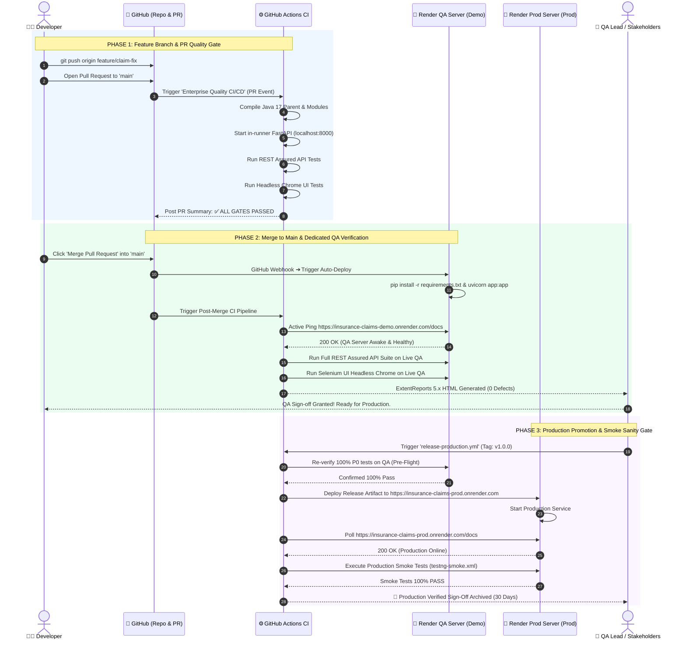

# 🌟 Enterprise CI/CD & Dual-Environment Quality Architecture
### Interactive End-to-End Visual Flow: From Code Commit to QA & Production Sign-Off

> **Architecture At A Glance**: Look at the diagrams below to understand the complete lifecycle of how code moves from a developer's feature branch through automated QA verification on Render, and finally to verified Production deployment.

---

## 🗺️ Master Visual Architecture Map

```mermaid
flowchart TD
    %% Styling Definitions
    classDef dev fill:#e0f2fe,stroke:#0284c7,stroke-width:2px,color:#0369a1,rx:10,ry:10;
    classDef pr fill:#fef3c7,stroke:#d97706,stroke-width:2px,color:#92400e,rx:10,ry:10;
    classDef qa fill:#dcfce7,stroke:#16a34a,stroke-width:2px,color:#166534,rx:10,ry:10;
    classDef prod fill:#f3e8ff,stroke:#9333ea,stroke-width:2px,color:#6b21a8,rx:10,ry:10;
    classDef failure fill:#fee2e2,stroke:#dc2626,stroke-width:2px,color:#991b1b,rx:10,ry:10;
    classDef gate fill:#1e293b,stroke:#0f172a,stroke-width:2px,color:#ffffff,rx:10,ry:10;

    %% Lane 1: Development
    subgraph LANE1 ["💻 1. DEVELOPER WORKSPACE"]
        DEV_CODE["Feature Branch: feature/claim-fix<br/>• Writes Code in demo-app/ or automation/<br/>• Runs Local Pre-Flight: mvn test-compile"]:::dev
        PUSH_PR["git push & Open Pull Request<br/>(feature/claim-fix ➔ main)"]:::dev
    end

    %% Lane 2: PR Gating
    subgraph LANE2 ["⚡ 2. PRE-MERGE QUALITY GATE (GitHub Actions CI)"]
        PR_BUILD["Stage 1: Build Verification<br/>• Java 17 compile across all 3 modules"]:::pr
        PR_EPHEMERAL["Stage 2 & 3: Ephemeral Runner<br/>• Runs FastAPI in-runner (localhost:8000)<br/>• REST Assured API Suite (P0 Gate)"]:::pr
        PR_UI["Stage 4: Headless Selenium UI<br/>• Headless Chrome E2E Journeys"]:::pr
        PR_VERDICT{"Stage 5: Quality Gate<br/>100% Pass Rate?"}:::gate
        PR_BLOCKED["❌ MERGE BLOCKED<br/>Defect Caught Before Merge!"]:::failure
        PR_MERGE["✅ PR APPROVED<br/>Merge into 'main' Allowed"]:::qa
    end

    %% Lane 3: Dedicated QA
    subgraph LANE3 ["🧪 3. DEDICATED QA ENVIRONMENT (Render.com)"]
        QA_DEPLOY["🚀 Auto-Deploy to QA Server<br/>https://insurance-claims-demo.onrender.com"]:::qa
        QA_WAKE["Automatic Server Wake-up<br/>Polls /docs until 200 OK"]:::qa
        QA_SUITE["🔬 Live QA Regression Suite<br/>• REST Assured API Boundary Tests<br/>• Selenium Headless UI Journeys"]:::qa
        QA_REPORT["📊 ExtentReports 5.x HTML Published<br/>Retained 14 Days in CI Artifacts"]:::qa
        NIGHTLY_CRON["🌙 Nightly 00:00 UTC Cross-Browser Matrix<br/>Parallel Runs on Chrome & Firefox"]:::qa
    end

    %% Lane 4: Production
    subgraph LANE4 ["🚀 4. DEDICATED PRODUCTION ENVIRONMENT (Render.com)"]
        PROD_TRIGGER["Trigger Production Release<br/>• Push Tag: git tag v1.0.0 OR<br/>• 1-Click UI: release-production.yml"]:::prod
        PROD_GATE1["Stage 1: QA Pre-Flight Check<br/>Validates 100% Pass on QA first"]:::prod
        PROD_DEPLOY["Stage 2: Live Production Deploy<br/>https://insurance-claims-prod.onrender.com"]:::prod
        PROD_SMOKE["Stage 3: Live Smoke Sanity Gate<br/>• Critical API calculation check<br/>• Live Production homepage & journeys"]:::prod
        PROD_LIVE["🎉 PRODUCTION LIVE & VERIFIED!<br/>Zero-Defect Release Sign-Off (30-day Reports)"]:::prod
    end

    %% Flow Connections
    DEV_CODE --> PUSH_PR
    PUSH_PR --> PR_BUILD
    PR_BUILD --> PR_EPHEMERAL
    PR_EPHEMERAL --> PR_UI
    PR_UI --> PR_VERDICT

    PR_VERDICT -->|No / Regression| PR_BLOCKED
    PR_VERDICT -->|Yes / 0 Defects| PR_MERGE

    PR_MERGE -->|Merge to 'main'| QA_DEPLOY
    QA_DEPLOY --> QA_WAKE
    QA_WAKE --> QA_SUITE
    QA_SUITE --> QA_REPORT
    QA_REPORT -.-> NIGHTLY_CRON

    QA_REPORT ==>|QA Lead Sign-Off| PROD_TRIGGER
    PROD_TRIGGER --> PROD_GATE1
    PROD_GATE1 --> PROD_DEPLOY
    PROD_DEPLOY --> PROD_SMOKE
    PROD_SMOKE --> PROD_LIVE
```



---

## 🎬 Step-by-Step Sequence Animation (Lifecycle Diagram)

This sequence diagram illustrates the exact communication between **Developer, GitHub Actions, Render QA, and Render Production**:



---

## 📋 Environment & Pipeline Quick Reference Matrix

| Metric | 🧪 Dedicated QA Environment | 🚀 Dedicated Production Environment |
| :--- | :--- | :--- |
| **Live Web URL** | [https://insurance-claims-demo.onrender.com](https://insurance-claims-demo.onrender.com) | [https://insurance-claims-prod.onrender.com](https://insurance-claims-prod.onrender.com) |
| **API Docs (Swagger)** | `/docs` | `/docs` |
| **Target Audience** | QA Engineers, Developers, Automation Suites | Real End Users, Live Insurance Claims |
| **Deploy Mechanism** | Continuous Auto-deploy on merge to `main` | Controlled Release Tag (`v*.*.*`) / Manual Approval |
| **Active Pipelines** | `ci.yml` & `nightly-crossbrowser.yml` | `release-production.yml` |
| **Automated Test Scope**| 100% P0/P1 Calculation, Boundary & UI Regressions | Critical Path Smoke Tests (`testng-smoke.xml`) |
| **Report Retention** | 14 Days (ExtentReports HTML Spark) | 30 Days (Release Sign-off Dashboards) |

---

## 🎯 Key Takeaway for Architects & Interviewers

```
                ┌────────────────────────────────────────────────────────┐
                │             THE GOLDEN 3-STAGE QUALITY RULE            │
                ├────────────────────────────────────────────────────────┤
                │ 1. PR Branch Gate  ➔ Protects the 'main' branch        │
                │ 2. Live QA Gate    ➔ Validates System Integration (SIT)│
                │ 3. Prod Smoke Gate ➔ Confirms Safe Customer Release    │
                └────────────────────────────────────────────────────────┘
```
