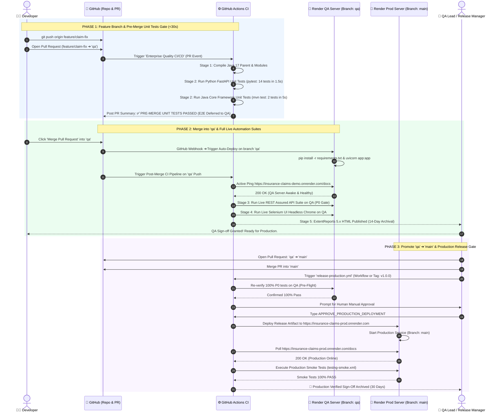

# 🌟 Enterprise CI/CD & Dual-Environment Quality Architecture
### Interactive End-to-End Visual Flow: From Code Commit to QA & Production Sign-Off

> **Architecture At A Glance**: Look at the diagrams below to understand the complete lifecycle of how code moves from a developer's feature branch through automated QA verification on Render, and finally to verified Production deployment.

---

## 🗺️ Master Visual Architecture Map

```mermaid
flowchart TD
    %% Styling Definitions
    classDef dev fill:#e0f2fe,stroke:#0284c7,stroke-width:2px,color:#0369a1,rx:10,ry:10;
    classDef pr fill:#fef3c7,stroke:#d97706,stroke-width:2px,color:#92400e,rx:10,ry:10;
    classDef qa fill:#dcfce7,stroke:#16a34a,stroke-width:2px,color:#166534,rx:10,ry:10;
    classDef prod fill:#f3e8ff,stroke:#9333ea,stroke-width:2px,color:#6b21a8,rx:10,ry:10;
    classDef failure fill:#fee2e2,stroke:#dc2626,stroke-width:2px,color:#991b1b,rx:10,ry:10;
    classDef gate fill:#1e293b,stroke:#0f172a,stroke-width:2px,color:#ffffff,rx:10,ry:10;

    %% Lane 1: Development
    subgraph LANE1 ["💻 1. DEVELOPER WORKSPACE"]
        DEV_CODE["Feature Branch: feature/claim-fix<br/>• Writes Code in demo-app/ or automation/<br/>• Runs Local Pre-Flight: pytest & mvn test-compile"]:::dev
        PUSH_PR["git push & Open Pull Request<br/>(feature/claim-fix ➔ qa branch)"]:::dev
    end

    %% Lane 2: PR Gating
    subgraph LANE2 ["⚡ 2. PRE-MERGE QUALITY GATE (Fast Unit Tests Only)"]
        PR_BUILD["Stage 1: Build Verification<br/>• Java 17 compile across all 3 modules"]:::pr
        PR_UNIT["Stage 2: Fast Pre-Merge Unit Tests<br/>• FastAPI Pytest Unit Tests (< 2s)<br/>• Java Core Framework Unit Tests (< 5s)"]:::pr
        PR_VERDICT{"Stage 5: Quality Gate<br/>100% Unit Tests Pass?"}:::gate
        PR_BLOCKED["❌ MERGE BLOCKED<br/>Unit Test Assertion Failed!"]:::failure
        PR_MERGE["✅ PR APPROVED<br/>Merge into 'qa' Allowed (< 30s Loop)"]:::qa
    end

    %% Lane 3: Dedicated QA
    subgraph LANE3 ["🧪 3. DEDICATED QA ENVIRONMENT (Render.com)"]
        QA_DEPLOY["🚀 Auto-Deploy to QA Server<br/>Branch: 'qa'<br/>https://insurance-claims-demo.onrender.com"]:::qa
        QA_WAKE["Server Wake-up & Health Check<br/>Polls /docs until 200 OK"]:::qa
        QA_API["Stage 3: Live REST Assured API Suite<br/>• P0 Financial & Boundary Regression Gate"]:::qa
        QA_UI["Stage 4: Live Headless Selenium UI Suite<br/>• Multi-step E2E Claims Journeys"]:::qa
        QA_REPORT["📊 Stage 5: ExtentReports 5.x HTML Published<br/>Retained 14 Days in CI Artifacts"]:::qa
        NIGHTLY_CRON["🌙 Nightly 00:00 UTC Cross-Browser Matrix<br/>Parallel Runs on Chrome & Firefox"]:::qa
    end

    %% Lane 4: Production
    subgraph LANE4 ["🚀 4. DEDICATED PRODUCTION ENVIRONMENT (Render.com)"]
        PROD_PR["Open PR: 'qa' ➔ 'main'<br/>(Release Candidate Sign-Off)"]:::prod
        PROD_TRIGGER["Trigger Production Release Pipeline<br/>• Push Tag: git tag v1.0.0 OR<br/>• 1-Click UI: release-production.yml"]:::prod
        PROD_GATE1["Stage 1: QA Pre-Flight Check<br/>Validates 100% Pass on QA first"]:::prod
        PROD_HUMAN_GATE{"🛑 HUMAN MANUAL APPROVAL<br/>QA Lead / Release Manager Sign-off<br/>Approve and Deploy?"}:::gate
        PROD_DEPLOY["Stage 2: Live Production Deploy<br/>Branch: 'main'<br/>https://insurance-claims-prod.onrender.com"]:::prod
        PROD_SMOKE["Stage 3: Live Smoke Sanity Gate<br/>• Critical API calculation check<br/>• Live Production homepage & journeys"]:::prod
        PROD_LIVE["🎉 PRODUCTION LIVE & VERIFIED!<br/>Zero-Defect Release Sign-Off (30-day Reports)"]:::prod
    end

    %% Flow Connections
    DEV_CODE --> PUSH_PR
    PUSH_PR --> PR_BUILD
    PR_BUILD --> PR_UNIT
    PR_UNIT --> PR_VERDICT

    PR_VERDICT -->|No / Regression| PR_BLOCKED
    PR_VERDICT -->|Yes / 0 Defects| PR_MERGE

    PR_MERGE -->|Merge to 'qa'| QA_DEPLOY
    QA_DEPLOY --> QA_WAKE
    QA_WAKE --> QA_API
    QA_API --> QA_UI
    QA_UI --> QA_REPORT
    QA_REPORT -.-> NIGHTLY_CRON

    QA_REPORT ==>|QA Sign-Off: Create PR| PROD_PR
    PROD_PR -->|Merge into 'main'| PROD_TRIGGER
    PROD_TRIGGER --> PROD_GATE1
    PROD_GATE1 --> PROD_HUMAN_GATE
    PROD_HUMAN_GATE -->|Approved by Human| PROD_DEPLOY
    PROD_HUMAN_GATE -.->|Rejected / Blocked| PROD_GATE1
    PROD_DEPLOY --> PROD_SMOKE
    PROD_SMOKE --> PROD_LIVE
```



---

## 🎬 Step-by-Step Sequence Animation (Lifecycle Diagram)

This sequence diagram illustrates the exact communication between **Developer, GitHub Actions, Render QA, and Render Production**:



---

## 🔄 Dynamic Enterprise State Machine (Ticket/Code Lifecycle Flow)

This state diagram visualizes the exact states, decision gates, and transitions every commit undergoes before reaching customers:

```mermaid
stateDiagram-v2
    direction TB

    [*] --> FeatureBranch: 💻 Developer creates branch 'feature/*' from 'qa'
    
    state FeatureBranch {
        [*] --> CodeDevelopment: Writes code in demo-app/ or automation/
        CodeDevelopment --> LocalPreFlight: Run local pytest & mvn test-compile
        LocalPreFlight --> PushRemote: git push -u origin feature/*
    }

    PushRemote --> PullRequestQA: 🐙 Open Pull Request to 'qa'

    state PullRequestQA {
        [*] --> Stage1_Build: GitHub Actions 'ci.yml' Triggered
        Stage1_Build --> Stage2_FastUnitTests: Run Pytest & Java Core Unit Tests
        Stage2_FastUnitTests --> Stage5_GateVerdict: Evaluate Unit Testing Gate (< 30s)
        
        Stage5_GateVerdict --> PR_Blocked: ❌ Unit Test Assertion Failed
        Stage5_GateVerdict --> PR_Approved: ✅ 100% Pass Rate (E2E Deferred)
    }

    PR_Blocked --> CodeDevelopment: Fix bug on local feature branch
    PR_Approved --> MergeQA: 🔀 Click 'Merge pull request' into 'qa'

    state MergeQA {
        [*] --> RenderQAHook: Render Webhook Detects 'qa' Push
        RenderQAHook --> BuildQAService: pip install & uvicorn restart
        BuildQAService --> QALiveActive: 🧪 Deployed to insurance-claims-demo
    }

    MergeQA --> QAVerification: 🔬 Full Automation Suites on Live QA

    state QAVerification {
        [*] --> PostMergeCI: 'ci.yml' triggers on 'qa' Push
        PostMergeCI --> Stage3_APIGate: Live REST Assured API Suite (P0)
        Stage3_APIGate --> Stage4_UIGate: Live Headless Selenium 4 UI Journeys
        Stage4_UIGate --> ExtentReportsPublished: ExtentReports 5.x HTML Published (14d)
        ExtentReportsPublished --> NightlyMatrix: 🌙 00:00 UTC Chrome + Firefox
        NightlyMatrix --> QASignOffGranted: 👔 QA Lead Signs Off
    }

    QASignOffGranted --> PullRequestMain: 🚀 Open PR 'qa' ➔ 'main'

    state PullRequestMain {
        [*] --> MergeMain: PR Approved & Merged into 'main'
        MergeMain --> ProdTrigger: Trigger 'release-production.yml' (Tag / UI)
        ProdTrigger --> QA_PreFlightCheck: Re-verify 100% P0 on QA First
        QA_PreFlightCheck --> HumanApprovalGate: 🛑 Human Operator Confirmation
        HumanApprovalGate --> ProdDeployment: Deploy to insurance-claims-prod
        ProdDeployment --> LiveSmokeGate: Run testng-smoke.xml on Production
    }

    PullRequestMain --> ProductionVerifiedLive: 🎉 ZERO-DEFECT PRODUCTION LIVE
    ProductionVerifiedLive --> [*]
```



---

## ⚡ High-Velocity Code Promotion Pipeline (Live Path)

```
  ┌─────────────────┐       PR to 'qa'       ┌────────────────────────┐
  │ 💻 DEVELOPER    ├───────────────────────►│ ⚡ PRE-MERGE UNIT GATE  │
  │ feature/xyz     │                        │  • Build Verification  │
  └─────────────────┘                        │  • FastAPI Unit Tests  │
                                             │  • Core Java Unit Tests│
                                             └───────────┬────────────┘
                                                         │ 100% Pass (<30s)
                                                         ▼
  ┌─────────────────────────────────┐   Auto-Deploy  ┌────────────────────────┐
  │ 🧪 DEDICATED QA ENVIRONMENT     │◄───────────────┤ 🐙 'qa' BRANCH MERGE   │
  │ insurance-claims-demo.onrender  │                └───────────┬────────────┘
  │  • REST Assured API Suite (P0)  │                            │
  │  • Selenium Headless UI Suite   │◄───────────────────────────┘
  │  • ExtentReports 5.x HTML (14d) │      Runs Live Test Automation
  │  • Nightly Matrix (Chrome+FF)   │
  └────────────────┬────────────────┘
                   │ QA Lead Sign-off
                   ▼
  ┌─────────────────────────────────┐   Merge & Gate ┌────────────────────────┐
  │ 🛑 PRODUCTION HUMAN GATE        ├───────────────►│ 🚀 'main' BRANCH MERGE │
  │ 'APPROVE_PRODUCTION_DEPLOYMENT' │                └───────────┬────────────┘
  └─────────────────────────────────┘                            │
                                                                 ▼
  ┌─────────────────────────────────┐   Live Smoke   ┌────────────────────────┐
  │ 🎉 PRODUCTION VERIFIED LIVE     │◄───────────────┤ 🌐 LIVE PROD DEPLOY    │
  │ insurance-claims-prod.onrender  │                │ insurance-claims-prod  │
  └─────────────────────────────────┘                └────────────────────────┘
```

---

## 📋 Environment & Pipeline Quick Reference Matrix

| Metric | 🧪 Dedicated QA Environment | 🚀 Dedicated Production Environment |
| :--- | :--- | :--- |
| **Tracked Git Branch** | `qa` | `main` |
| **Live Web URL** | [https://insurance-claims-demo.onrender.com](https://insurance-claims-demo.onrender.com) | [https://insurance-claims-prod.onrender.com](https://insurance-claims-prod.onrender.com) |
| **API Docs (Swagger)** | `/docs` | `/docs` |
| **Target Audience** | QA Engineers, Developers, Automation Suites | Real End Users, Live Insurance Claims |
| **Deploy Mechanism** | Continuous Auto-deploy on merge to `qa` branch | Controlled Release Tag (`v*.*.*`) / PR to `main` with Human Approval |
| **Active Pipelines** | `ci.yml` & `nightly-crossbrowser.yml` | `release-production.yml` |
| **Automated Test Scope**| 100% P0/P1 Calculation, Boundary & UI Regressions | Critical Path Smoke Tests (`testng-smoke.xml`) |
| **Report Retention** | 14 Days (ExtentReports HTML Spark) | 30 Days (Release Sign-off Dashboards) |

---

## 🎯 Key Takeaway for Architects & Interviewers

```
                ┌────────────────────────────────────────────────────────┐
                │          ENTERPRISE BRANCH & GATE HIERARCHY            │
                ├────────────────────────────────────────────────────────┤
                │ 1. feature/* ➔ PR to 'qa'   (In-Runner Test Gate)     │
                │ 2. Merge to 'qa'            (Auto-Deploy QA & Test)    │
                │ 3. PR 'qa' ➔ 'main'         (Human Approval Gate)      │
                │ 4. Deploy 'main' to Prod    (Live Smoke Sanity Gate)   │
                └────────────────────────────────────────────────────────┘
```
